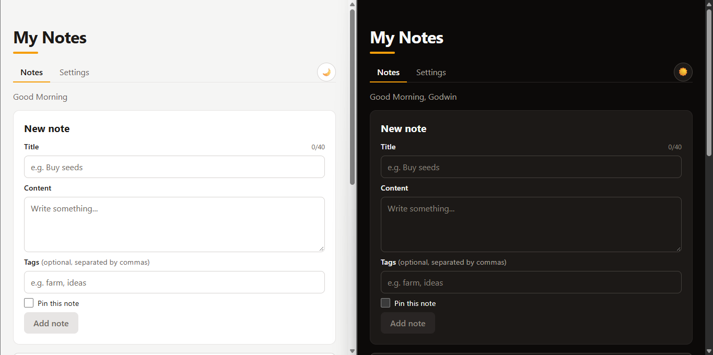

# My Notes

A fast, private, accessible notes app built with React. Notes are stored in your browser, so nothing is sent to a server.

**Live demo:** [\[your-deployed-url\]](https://memonestnotes.vercel.app/)



## Features

- Create, edit, pin and delete notes
- Tags, search, "pinned only" filter and sorting
- Light, dark and system themes
- Note pages with their own URLs, and a settings page
- Custom accessible confirmation dialog
- Keyboard shortcuts (`/` focuses search, `Esc` cancels, `Ctrl/⌘ + Enter` saves)
- Responsive and accessible (Lighthouse accessibility: 100)

## Tech stack

React 19, Vite, React Router, plain CSS with custom properties, Vitest and React Testing Library.

## Getting started

Requires Node 24 (22.22 or newer also works).

```bash
git clone [https://github.com/Godwinzin/Notes-App.git]
cd notes-app
npm install
npm run dev
```

Run the tests with `npm test`.

## Design decisions

- **State:** notes live in a reducer exposed through Context, so every way a note can change is in one place.
- **Persistence:** state is synced to `localStorage`, with safe fallbacks for missing or corrupted data.
- **Theming:** all colors are CSS variables, switched by a `data-theme` attribute, with no flash on load.
- **Performance:** memoized note cards and lazy-loaded pages, checked with the React DevTools profiler.

## Limitations

Notes are stored only in your browser, so they don't sync between devices, and clearing browser data deletes them.

## License

MIT © [Godwin]